# Lab9Web - Praktikum 9: PHP Modular

| | |
|---|---|
| **Nama** | Riksa Siddiq Alrizki |
| **NIM** | 312510015 |
| **Kelas** | I253A |
| **Program Studi** | Teknik Informatika |
| **Mata Kuliah** | Pemrograman Web |
| **Topik** | PHP Modular: modularisasi program, function, template, dan routing |

## 1. Tujuan Project
Project ini menerapkan modularisasi pada aplikasi PHP dengan memisahkan bagian program ke dalam file yang memiliki tanggung jawab jelas:

- memahami perbedaan `include`, `require`, `include_once`, dan `require_once`;
- membuat template halaman (header dan footer) yang dipakai bersama;
- membuat function PHP dengan parameter, nilai default, dan nilai kembalian;
- menyusun struktur direktori aplikasi secara modular;
- membuat router sederhana berdasarkan parameter URL (`index.php?page=...`) dengan whitelist rute dan halaman 404;
- mengintegrasikan semuanya ke aplikasi database: CRUD **Data Barang** dan CRUD **Data Pengguna** yang dilengkapi login dan logout.

## 2. Kebutuhan Perangkat
- XAMPP (Apache dan MySQL/MariaDB)
- PHP 8.1 atau lebih baru (ekstensi `pdo_mysql`; ekstensi `gd` disarankan untuk upload foto)
- Browser (Google Chrome) dan Visual Studio Code
- Git dan akun GitHub

## 3. Cara Menjalankan
1. Salin folder `Lab9Web` ke `C:\xampp\htdocs\`.
2. Buka XAMPP Control Panel, lalu **Start** Apache dan MySQL.
3. Buka `http://localhost/phpmyadmin`, pilih database `latihan1`, lalu impor atau jalankan `database/latihan1.sql` (membuat tabel `data_barang` dan `users`).
4. Sesuaikan koneksi di `config/database.php` jika perlu (default XAMPP: user `root`, tanpa password, database `latihan1`).
5. Buka `http://localhost/Lab9Web/`. Aplikasi akan mengarahkan ke halaman login.
6. Akun contoh: `admin` / `admin123`.

Halaman latihan yang berdiri sendiri (tanpa router) dibuka langsung, misalnya:
- `http://localhost/Lab9Web/latihan/uji-include.php`
- `http://localhost/Lab9Web/template/home.php`
- `http://localhost/Lab9Web/latihan%20function/halaman-a.php`

## 4. Struktur Direktori
```
Lab9Web/
├── index.php                  # titik masuk aplikasi dan router (whitelist rute)
├── .htaccess                  # URL rewrite (opsional)
├── config/
│   └── database.php           # satu-satunya konfigurasi koneksi database (PDO)
├── views/
│   ├── header.php
│   ├── footer.php
│   ├── dashboard.php
│   └── 404.php
├── helpers/
│   └── functions.php          # function umum: e, formatRupiah, hitungDiskon, validasiEmail, ringkasTeks, CSRF, flash, login, upload
├── modules/
│   ├── auth/
│   │   ├── login.php
│   │   └── logout.php
│   ├── user/
│   │   ├── list.php
│   │   ├── add.php
│   │   ├── edit.php
│   │   └── delete.php
│   ├── barang/
│   │   ├── list.php
│   │   ├── add.php
│   │   ├── edit.php
│   │   ├── delete.php
│   │   └── _form.php
│   ├── halaman/
│   │   ├── profil.php
│   │   └── kontak.php
│   └── latihan/
│       └── function.php
├── assets/
│   ├── css/style.css
│   ├── js/app.js
│   └── uploads/               # foto pengguna
├── template/                  # praktik template (header, footer, home, about, profil, kontak, style.css)
├── latihan/                   # praktik include dan require (pesan, uji-include, uji-require)
├── latihan function/          # praktik function (contoh-function, helpers, halaman-a, halaman-b)
├── database/
│   └── latihan1.sql
└── screenshots/               # 1.png sampai 20.png
```

Tanggung jawab tiap bagian:

| Bagian | Tanggung jawab |
|---|---|
| `index.php` | Titik masuk, membaca parameter `page`, memeriksa whitelist dan status login, lalu memuat header, konten, dan footer |
| `config/` | Konfigurasi aplikasi, termasuk koneksi database |
| `views/` | Komponen tampilan yang dipakai bersama |
| `helpers/` | Function umum yang dipakai banyak modul |
| `modules/` | Fitur aplikasi yang dikelompokkan berdasarkan fungsi |
| `assets/` | File statis: CSS, JavaScript, dan foto upload |

## 5. Daftar Rute
Semua rute diakses lewat `index.php?page=<rute>`. Semua rute **wajib login**, kecuali `auth/login`.

| Rute | File | Keterangan |
|---|---|---|
| `auth/login` | modules/auth/login.php | Form login (satu-satunya rute publik) |
| `auth/logout` | modules/auth/logout.php | Logout (hanya POST dengan token CSRF) |
| `dashboard` | views/dashboard.php | Ringkasan data (rute default) |
| `barang/list` | modules/barang/list.php | Daftar barang |
| `barang/add` | modules/barang/add.php | Tambah barang |
| `barang/edit&id=N` | modules/barang/edit.php | Ubah barang |
| `barang/delete` | modules/barang/delete.php | Hapus barang (hanya POST) |
| `user/list` | modules/user/list.php | Daftar pengguna |
| `user/add` | modules/user/add.php | Tambah pengguna |
| `user/edit&id=N` | modules/user/edit.php | Ubah pengguna |
| `user/delete` | modules/user/delete.php | Hapus pengguna (hanya POST) |
| `halaman/profil` | modules/halaman/profil.php | Profil |
| `halaman/kontak` | modules/halaman/kontak.php | Form kontak |
| `latihan/function` | modules/latihan/function.php | Demo function helper |

Rute yang tidak terdaftar, kosong, atau bertipe tidak sesuai menghasilkan **HTTP 404** dan menampilkan `views/404.php`.

## 6. Langkah Praktikum dan Hasil

### 6.1 Menguji `include` dan `require`
Folder `latihan/` berisi tiga file: `pesan.php` (mencetak teks), `uji-include.php` (memanggil dengan `include`), dan `uji-require.php` (memanggil dengan `require`). Kodenya memakai `__DIR__` agar path tidak bergantung pada lokasi pemanggilan.

**Gambar 1 - `pesan.php` dibuka langsung.** File menampilkan teks "Ini isi pesan.php".

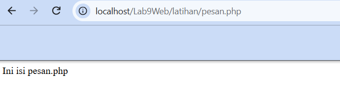

**Gambar 2 - `uji-include.php`.** Urutan keluaran: "Sebelum pemanggilan", isi `pesan.php`, lalu "Sesudah pemanggilan". Ini membuktikan isi file lain dijalankan di tempat `include` dipanggil.

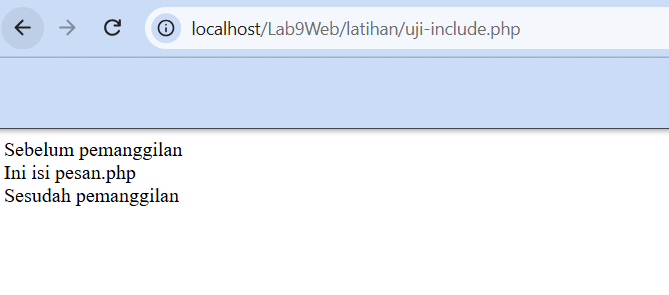

**Gambar 3 - `uji-require.php` saat `pesan.php` tidak ada.** Nama `pesan.php` diubah sementara. Muncul *Warning* karena gagal membuka file, lalu *Fatal error* yang menghentikan eksekusi. Teks "Sesudah pemanggilan" **tidak tampil**.

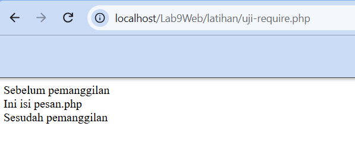

**Kesimpulan:**

| Konstruksi | Jika file tidak ditemukan |
|---|---|
| `include` | Warning, eksekusi **berlanjut** |
| `require` | Fatal error, eksekusi **berhenti** |
| `include_once` / `require_once` | Sama seperti di atas, tetapi file hanya dimuat satu kali |

### 6.2 Template layout
Folder `template/` berisi `header.php`, `footer.php`, dan halaman `home.php`, `about.php`, `profil.php`, `kontak.php`. Setiap halaman hanya memuat konten sendiri dan memanggil header serta footer dengan `require_once`.

**Gambar 4 - `home.php`**


**Gambar 5 - `about.php`**

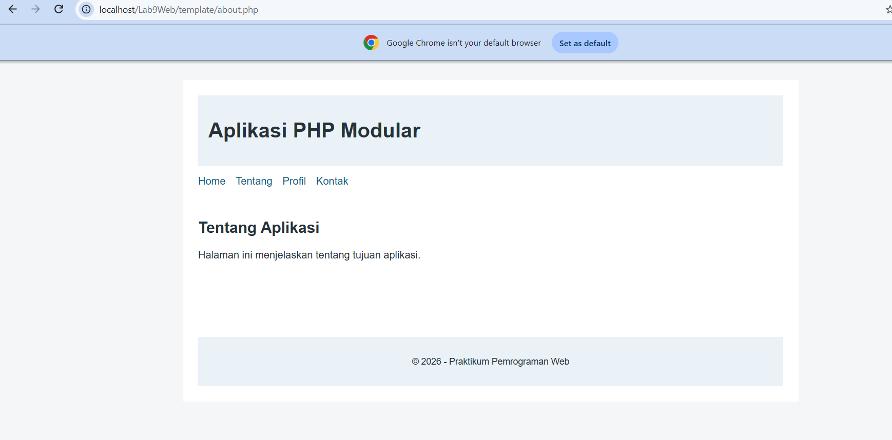

**Gambar 6 - `profil.php`**

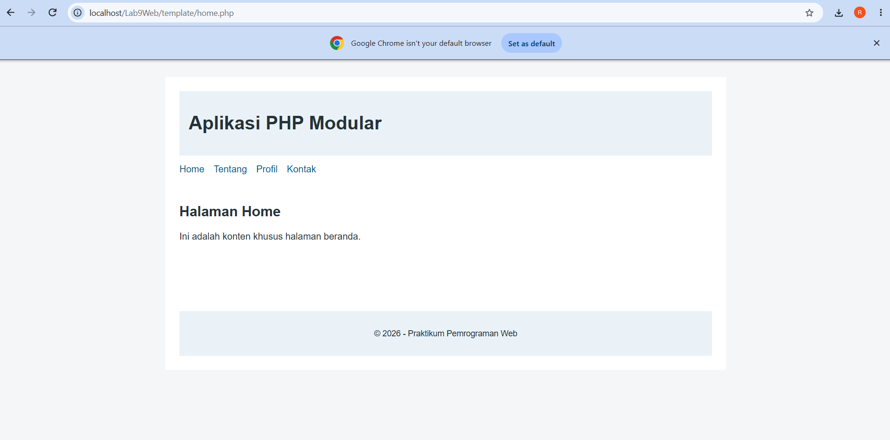

**Gambar 7 - `kontak.php`**

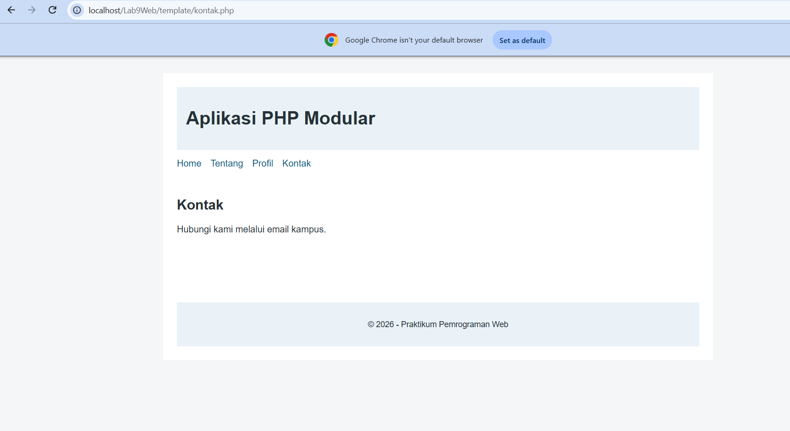

Keempat halaman memiliki header, navigasi, dan footer yang sama, sedangkan konten utamanya berbeda.

**Analisis hasil:**
- *Bagian yang dipakai bersama:* header (judul dan navigasi), footer, dan `style.css`.
- *Jika teks navigasi diubah di `header.php`:* perubahan langsung terlihat di semua halaman tanpa mengubah file halaman satu per satu.
- *Mengapa konten tidak diletakkan di `header.php`:* header berisi bagian yang sama untuk semua halaman, sedangkan konten berbeda tiap halaman. Jika digabung, template tidak bisa dipakai ulang.
- *Manfaat `require_once` dibanding menyalin kode:* kode tidak berulang, perubahan cukup di satu tempat, dan file tidak dimuat dua kali.

### 6.3 Function dan file helper
Folder `latihan function/` berisi `contoh-function.php` serta file `helpers.php` yang dipanggil dari dua halaman berbeda (`halaman-a.php` dan `halaman-b.php`) lewat `require_once`.

**Gambar 8 - `halaman-a.php`.** Memanggil `formatRupiah()`, `hitungTotal()`, `hitungDiskon()` (diskon bawaan 10%), dan `e()`. Keluaran: harga Rp 150.000, total 3 barang Rp 450.000, diskon 10% Rp 45.000. Fungsi `e()` menampilkan `<script>` sebagai teks biasa, bukan menjalankannya.

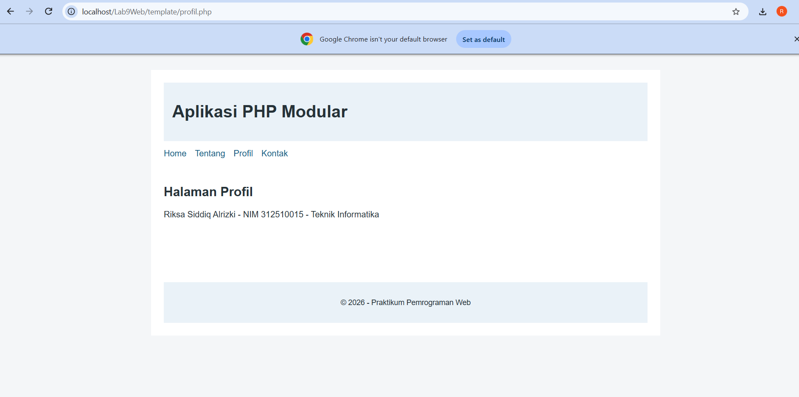

**Gambar 9 - `halaman-b.php`.** Memanggil `konversiCelciusKeFahrenheit()`, `tentukanStatusNilai()`, dan `hitungDiskon()` dengan argumen 15. Keluaran: 36 C = 96.8 F, nilai 78 = B, diskon 15% Rp 30.000.


### 6.4 Struktur database
Database `latihan1` berisi tabel `data_barang` (praktikum sebelumnya) dan tabel `users` untuk login.

**Gambar 20 - tabel `data_barang` di phpMyAdmin.** Kolom: `id_barang`, `kategori`, `nama`, `gambar`, `harga_beli`, `harga_jual`, `stok`. Kolom `gambar` belum ditampilkan pada halaman Data Barang versi ini.

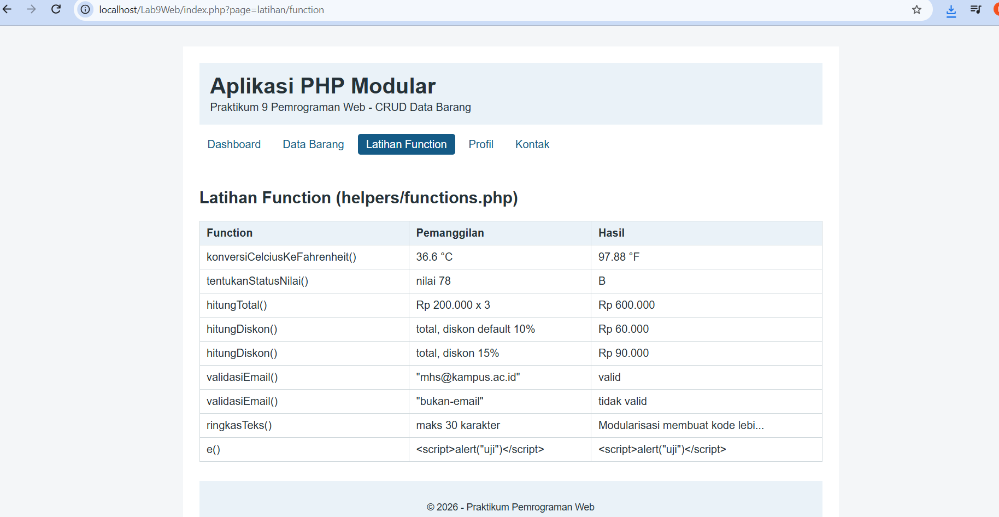

### 6.5 Login dan dashboard
Halaman login adalah satu-satunya rute publik. Password dicek dengan `password_verify()` terhadap hash di tabel `users`, dan form dilindungi token CSRF.

**Gambar 10 - halaman login** (`index.php?page=auth/login`). Berisi kolom Username, Password, dan tombol Masuk. Menu navigasi tidak ditampilkan sebelum login.

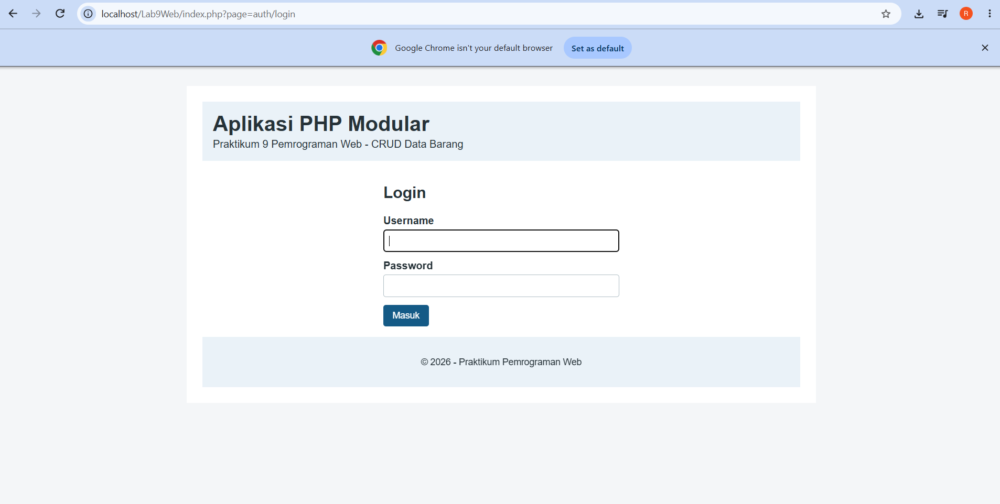

**Gambar 11 - dashboard setelah login.** Muncul pesan "Selamat datang, Administrator." beserta menu lengkap, nama pengguna, dan tombol Logout. Ringkasan menampilkan 4 jenis barang, total stok 19, nilai stok Rp 70.500.000, total pengguna 4, dan login sebagai `admin`.

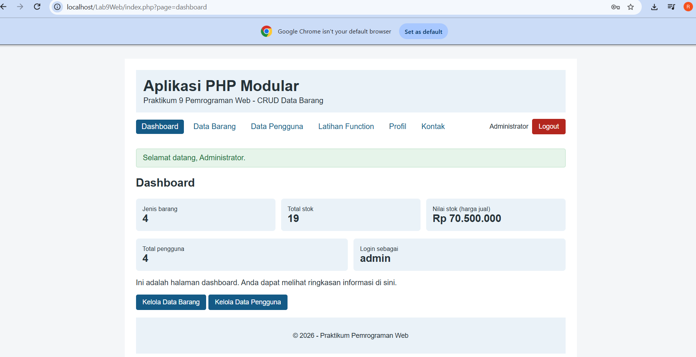

### 6.6 CRUD Data Barang lewat router
**Gambar 12 - daftar barang** (`?page=barang/list`). Tabel menampilkan 4 barang dengan harga yang diformat memakai `formatRupiah()`, serta tombol Ubah dan Hapus tiap baris. Menu "Data Barang" ditandai aktif.


**Gambar 13 - form tambah barang** (`?page=barang/add`).


**Gambar 14 - form ubah barang** (`?page=barang/edit&id=5`). Form terisi data barang yang dipilih.


Penghapusan hanya diproses lewat metode POST dengan token CSRF, tidak melalui URL biasa.

### 6.7 CRUD Data Pengguna
**Gambar 15 - daftar pengguna** (`?page=user/list`). Tabel memuat username, nama, email, dan kolom foto. Akun yang sedang login ditandai "(akun Anda)" dan tidak memiliki tombol Hapus, sehingga tidak bisa menghapus dirinya sendiri.

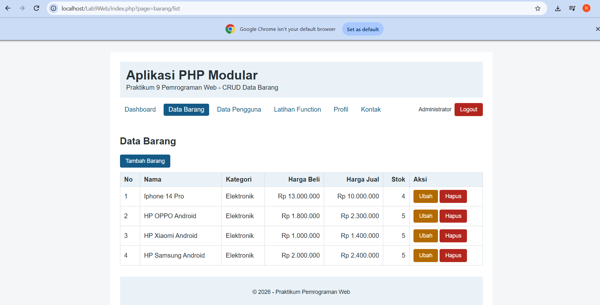

### 6.8 Function pada halaman router
**Gambar 16 - Latihan Function** (`?page=latihan/function`). Seluruh function di `helpers/functions.php` didemonstrasikan: konversi Celcius ke Fahrenheit (36.6 C menjadi 97.88 F), status nilai (78 menjadi B), total (Rp 600.000), diskon 10% (Rp 60.000) dan 15% (Rp 90.000), validasi email, ringkas teks, dan escape HTML.

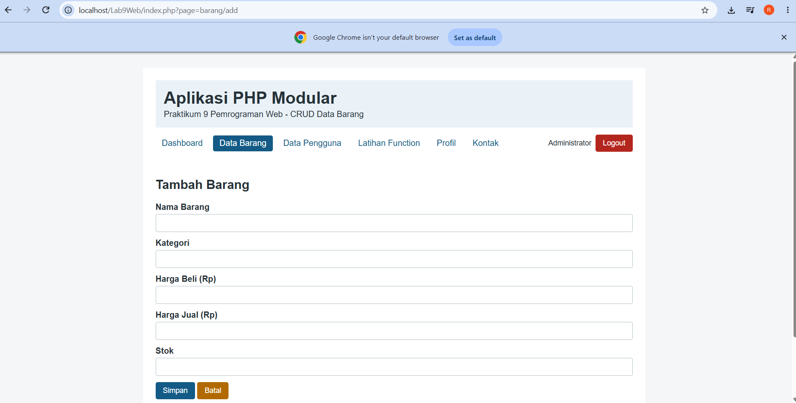

### 6.9 Halaman Profil dan Kontak
**Gambar 17 - profil** (`?page=halaman/profil`). Menampilkan data mahasiswa dan deskripsi singkat yang dipotong dengan `ringkasTeks()`.

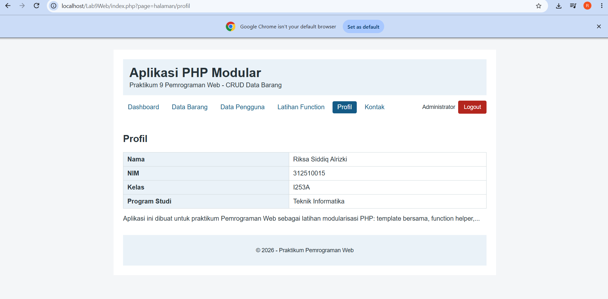

**Gambar 18 - kontak** (`?page=halaman/kontak`). Form Nama, Email, dan Pesan. Email divalidasi dengan `validasiEmail()`.

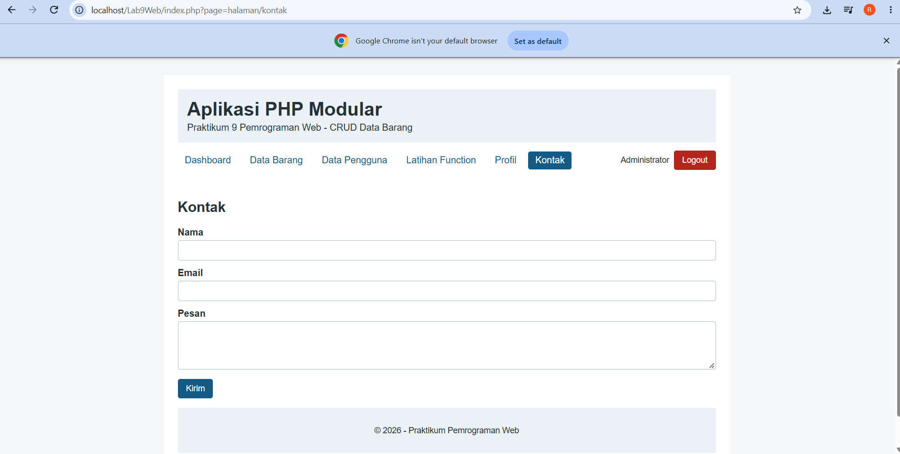

### 6.10 Routing aman dan halaman 404
**Gambar 19 - halaman 404.** URL yang tidak terdaftar (`localhost/Lab9Web/views/404`) menampilkan halaman "404 - Halaman tidak ditemukan" dengan template yang sama dan tombol kembali ke dashboard. Gambar ini juga menunjukkan URL rewrite `.htaccess` bekerja, karena alamat tanpa `index.php?page=` tetap diarahkan ke router.

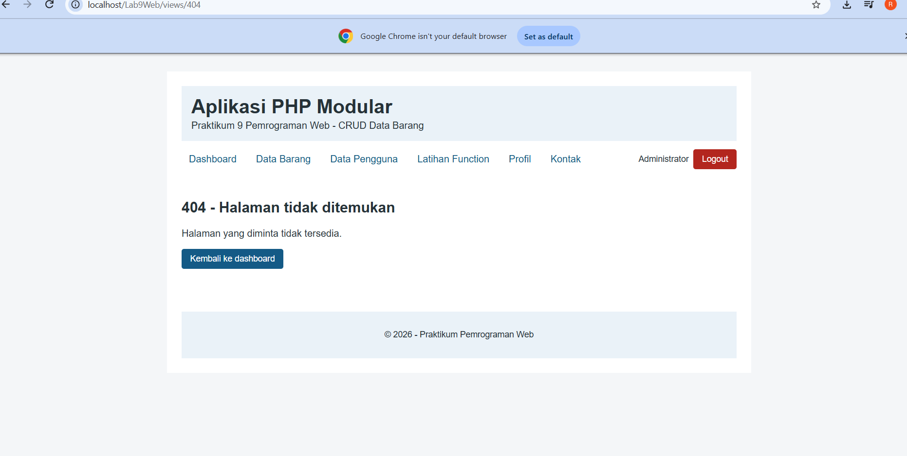

Router tidak menyusun path file dari input URL. Hanya rute yang ada di daftar `$routes` yang boleh dimuat:

```php
$page = $_GET['page'] ?? 'dashboard';

if (!is_string($page) || !array_key_exists($page, $routes)) {
    http_response_code(404);
    $contentFile = __DIR__ . '/views/404.php';
} else {
    $contentFile = $routes[$page]['file'];
}
```

## 7. Ringkasan Pengujian
| Pengujian | Bukti |
|---|---|
| `include` melanjutkan eksekusi, `require` menghentikannya jika file hilang | Gambar 2 dan 3 |
| Header, navigasi, dan footer dipakai bersama oleh semua halaman template | Gambar 4 sampai 7 |
| Function helper dipanggil dari dua halaman berbeda | Gambar 8 dan 9 |
| Login berhasil dan menu hanya muncul setelah login | Gambar 10 dan 11 |
| CRUD barang berjalan lewat router dan template bersama | Gambar 12 sampai 14 |
| CRUD pengguna berjalan; akun sendiri tidak bisa dihapus | Gambar 15 |
| Function helper dipakai di dalam aplikasi | Gambar 16 sampai 18 |
| Rute tidak terdaftar menampilkan halaman 404 | Gambar 19 |
| Koneksi database hanya dikelola di `config/database.php` | Gambar 12, 15, dan 20 |

## 10. Jawaban Pertanyaan Pemahaman
1. **Modularisasi** adalah membagi aplikasi menjadi bagian kecil berdasarkan tanggung jawabnya. Manfaatnya: kode dapat dipakai ulang (header dan footer tidak ditulis berulang), perubahan cukup dilakukan di satu file, dan aplikasi lebih mudah dirawat serta dikerjakan bersama.
2. Jika file yang dipanggil tidak ditemukan, `include` hanya menghasilkan *warning* dan eksekusi dilanjutkan, sedangkan `require` menghasilkan *fatal error* dan eksekusi dihentikan (Gambar 3).
3. Konfigurasi database wajib tersedia, sehingga dipakai `require`. Akhiran `_once` mencegah file dimuat berulang agar tidak terjadi koneksi atau deklarasi ganda.
4. **Parameter** adalah variabel pada deklarasi function, **argumen** adalah nilai yang dikirim saat function dipanggil, dan **nilai return** adalah nilai yang dikembalikan function kepada pemanggilnya sehingga dapat disimpan atau dipakai kembali.
5. Header dan footer sama di semua halaman, sedangkan konten berbeda. Dengan dipisahkan, tampilan konsisten dan perubahan layout cukup dilakukan sekali.
6. `index.php` adalah titik masuk aplikasi (router): membaca parameter `page`, memeriksanya pada daftar rute, lalu memuat header, konten, dan footer yang sesuai.
7. Whitelist membatasi halaman yang dapat dibuka hanya pada rute yang ditentukan aplikasi, sehingga input pengguna tidak dapat dipakai untuk mengakses file lain.
8. Jika input `page` langsung digabung menjadi path `require`, penyerang dapat memakai path traversal (`../`) untuk memuat file yang tidak dimaksudkan, misalnya file konfigurasi, sehingga data sensitif bocor atau kode berbahaya dijalankan.
9. `RewriteCond` menentukan syarat aturan berlaku (di sini: bukan file dan bukan direktori yang ada), sedangkan `RewriteRule` mengarahkan URL yang memenuhi syarat ke `index.php?page=...`.
10. **config**: koneksi database; **views**: header, footer, dashboard, 404; **helpers**: function umum (validasi, format, escape, CSRF); **modules**: halaman list, add, edit, delete serta login dan logout.

## 9. Kendala dan Cara Mengatasinya
| Kendala | Penyebab | Solusi |
|---|---|---|
| Tombol Ubah dan Hapus keluar dari kolom tabel | Aturan CSS `.aksi { display: flex }` dipasang pada sel tabel (`td`) sehingga merusak tata letak tabel | Mengganti dengan `.aksi { white-space: nowrap }` dan `.aksi form { display: inline-block }` |
| Gagal login dengan akun lama | Tabel `users` sudah ada sebelumnya dan password tersimpan sebagai teks biasa (panjang 8 karakter), padahal hash `password_hash()` panjangnya 60 karakter | Men-hash ulang password lama dengan `password_hash()` lewat skrip sementara, lalu skrip dihapus |
| Perubahan CSS tidak terlihat | Browser memakai CSS lama dari cache | Muat ulang dengan Ctrl + F5 dan menambahkan `?v=<filemtime>` pada tautan CSS |
| Tautan ke folder `latihan function` bermasalah | Nama folder mengandung spasi | Memakai `rawurlencode()` pada pembuatan URL sehingga spasi menjadi `%20` |

## 10. Catatan Keamanan
- Router memakai whitelist rute dan tidak menyusun path file dari input URL.
- Semua rute selain `auth/login` memeriksa status login terlebih dahulu.
- Password disimpan sebagai hash (`password_hash`) dan dicek dengan `password_verify`; ID sesi diperbarui saat login.
- Seluruh keluaran HTML di-escape dengan fungsi `e()` dan seluruh query memakai *prepared statement* (PDO).
- Operasi yang mengubah data (tambah, ubah, hapus, login, logout) memakai metode POST dengan token CSRF dan validasi di server.
- Detail error koneksi database tidak ditampilkan kepada pengguna.
- Folder `assets/uploads` menolak eksekusi file PHP, dan foto yang diupload divalidasi tipe serta ukurannya.
- File di `config/`, `helpers/`, `views/`, dan `modules/` menolak akses langsung lewat konstanta `APP_ROOT`.
